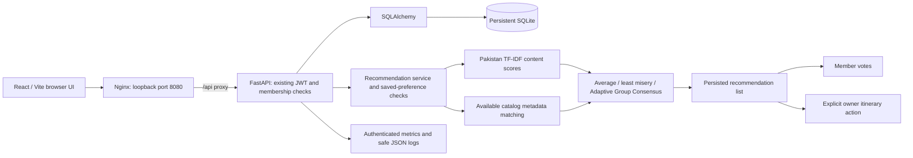
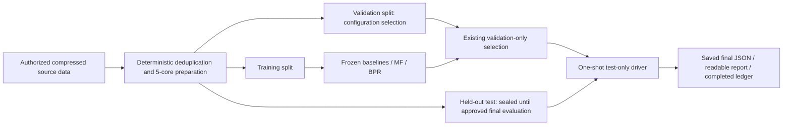

# HumSafar architecture

## Application request path

Voting and itinerary creation are separate actions. Both reference eligible,
current group recommendations. No diagram edge implies a vote creates a stop.
The backend rejects private-group access by nonmembers, preference changes for
another user, votes on another member's behalf, and unauthorized itinerary edits.
The database remains separate from training data and model files.

The API entrypoint is `backend.api.app:create_app` with Uvicorn's `--factory`.
Nginx strips `/api/`, serves the SPA history fallback and forwards to the
unpublished backend. Compose publishes only `127.0.0.1:8080`, runs non-root
containers, and mounts model artifacts read-only. No backend port is published.

## Identity and model routing

| Context | Behavior |
| --- | --- |
| Registered application user | Namespace `humsafar`; preferences/content matching. No historical identity linkage. |
| Compatible Pakistan attraction request | Saved 69-destination TF-IDF when compatible; explicit metadata fallback where supported. |
| Compatible historical Hawaii identity | Existing service/offline benchmark may use saved BPR factors plus training popularity. The public application API does not accept this identity namespace. |
| Hotel or other supported metadata request | Content/preference matching over genuine available fields; no worldwide trained user embeddings. |
| Missing coverage or incompatible mandatory restrictions | Explicit empty/conflict response; no invented place or silently relaxed restriction. |

The frozen historical hybrid is `0.75 * minmax(BPR score) + 0.25 *
minmax(log1p(training interaction count))`. Individual normalization uses that
user's training-unseen catalog; group candidates then exclude the union of
member histories without rescaling. This learned-ID capability does not
generalize automatically to new users, countries or attractions.

New application users must provide their own interests/preferences. The API
constructs application identities itself, preventing clients from impersonating
Hawaii dataset users. No fabricated embeddings, user ratings or training labels
are created from signup, votes, saved preferences or demonstration accounts.

## Catalog and application state

`backend/catalog.py` provides source-scoped stable IDs, schema validation,
source/country mapping and compatibility metadata. The actual catalog has
69 Pakistan attractions, 1,512 Hawaii attractions and 12,044 international hotel
source listings. There are 117 named country/territory labels and 726 unknown
countries; these are metadata counts, not worldwide personalization coverage.
Cross-source entity deduplication is not claimed.

SQLite tables are `users`, `travel_groups`, `group_memberships`,
`member_preferences`, `group_recommendations`, `votes`, `itinerary_items`, plus
`schema_info`. Foreign keys and membership checks tie votes/preferences to
members and recommendations to groups. SQLAlchemy configuration can later target
PostgreSQL; that database has not been integration-tested here.

The Docker database is `.local/docker-state/humsafar.db`. Native development
uses `backend/var/` by default. Container restarts preserve the Docker bind mount;
they do not migrate or overwrite the native database. JWT secrets stay in ignored
environment files. Passwords use the existing Argon2 hashing configuration;
browser access tokens stay in memory. No authentication changes are required
for recommendation or monitoring integration.

Preferences distinguish flexible countries/destinations from mandatory
restrictions. Country/location rules depend on actual metadata. Dates coordinate
member availability and constrain itinerary dates, not opening hours or venue
capacity. Budget/currency values are stored with explicit unsupported-filter
disclosures because comparable costs and live exchange rates are unavailable.

## Group consensus and evidence boundaries

Average aggregation ranks mean member scores; least misery ranks the minimum
member score. AGC builds a list sequentially using deficit-adaptive weights,
projected minimum utility and projected disparity. The frozen benchmark uses
average/minimum/fairness weights **0.5/0.3/0.2**, epsilon **0.05**, and ten items.
The reusable service accepts actual members' supplied/preference-derived scores;
it is not restricted to simulated historical groups.

Three different claims must remain separate:

1. **Individual ranking:** retrieval of one known positive holdout. The final
   hybrid Recall@10 is 0.221146 and NDCG@10 is 0.118196 over 23,844 eligible users.
2. **Predicted group utility/fairness:** normalized model-score list utilities,
   summarized by group mean, minimum and member range. AGC improved the predicted
   minimum/range in this benchmark, with lower mean utility than averaging.
3. **Observed group retrieval proxies:** binary retrieval of positive holdouts
   for eligible observed members only. Missing ratings are unknown. These
   fairness proxies were mixed, and group NDCG was lower for AGC than average
   aggregation at every tested size.

The final test groups are the same 500 fixed groups at each size 2/3/4/5 used in
the audited protocol, formed from training users only, seed 2026. Group relevance
is the union of eligible positive holdouts, not unanimous group preference.
These are simulated groups with overlapping users, not observed friend trips.
No real-human satisfaction or formal fairness guarantee follows from equal
numeric normalization. See [all final results](FINAL_EVALUATION.md).

## Offline research and application separation

The approved final evaluation already ran once. Its report and ledger—not a
fresh test run—are the sources for presentation. Selection used validation;
final results did not trigger new tuning or promotion. Serving artifacts and
validation outputs retain their hashes. The old registry manifest remains a
pre-test frozen reference, including its historical `test_evaluated:false` flag;
the final report/ledger record the subsequent test use.

The split is retrospective: full-graph 5-core and deduplication expose future
cohort information; timestamps have ties and no single global cutoff. Test
candidates exclude training visits only, retaining validation visits. One
holdout per user, unknown missing ratings and sparse group observations limit
evaluation. No international generalization is established by Hawaii results.

## Monitoring and deployment boundary

The API keeps process-local request/error counters, latency histograms and last
successful recommendation identifiers. `/api/metrics` requires an existing JWT.
Safe JSON logs contain route templates rather than private URLs or identifiers;
raw access logs and sensitive error text are suppressed. Metrics reset on backend
restart; bounded container logs and persistent SQLite have separate lifetimes.
This is local single-worker monitoring without Prometheus/Grafana infrastructure.

[MLOPS.md](MLOPS.md) describes artifact lineage and CI;
[DOCKER.md](DOCKER.md) describes the five-file serving bundle and operations;
[MONITORING.md](MONITORING.md) describes privacy and monitoring limits. Public
deployment still requires TLS, backup, secret/access reviews and shared rate
limiting. No AWS or live booking/payment integration is present.
