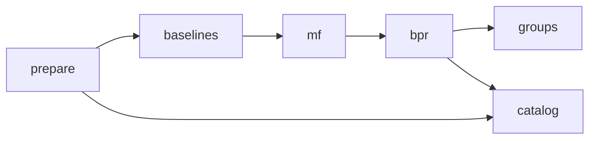

# HumSafar MLOps workflow

This guide describes the current Git-integrated DVC setup, local MLflow
provenance, frozen model references, CI and completed one-shot evaluation.
It supersedes the original Step 28 no-SCM/no-hosted-CI account. Detailed migration
evidence remains in [PIPELINE_REPRODUCIBILITY.md](PIPELINE_REPRODUCIBILITY.md).
No training, artifact replacement or final test rerun is needed for a demo.

## Sources, splits and objectives

The Hawaii benchmark contains 234,585 deduplicated 5-core interactions:
182,769 train, 25,908 validation and 25,908 test rows, for 25,908 users and
1,512 attractions. Per user, the latest interaction is test, second-latest
validation and the remainder train; timestamp ties use original attraction ID.
Latest-review deduplication and full-graph 5-core selection are retrospective
and introduce selection/temporal limitations.

Training-only baselines calculate rating means and popularity counts. MF fits
explicit ratings; BPR fits training ratings >=4 with comparisons sampled outside
the complete training history. Missing interactions are unknown, not verified
dislikes. Configuration selection used validation only:

- MF: lowest validation rating RMSE, a rating-prediction objective.
- BPR: highest validation NDCG@10, with deterministic tie handling.
- Hybrid: fixed selected weight 0.75 BPR / 0.25 training popularity, selected
  from the small validation search.
- AGC: fixed average/minimum/fairness weights 0.5/0.3/0.2, epsilon 0.05;
  no validation weight search was performed.

The final test was evaluated **once** after explicit approval and nine
synthetic-only protocol tests. The new report is not a selection input.

| Frozen ranking model | Test Recall@10 | Test NDCG@10 |
| --- | ---: | ---: |
| Popularity | 0.109629 | 0.052922 |
| Matrix Factorization | 0.002600 | 0.001074 |
| Pure BPR | 0.217623 | 0.115599 |
| 75% BPR + 25% popularity | 0.221146 | 0.118196 |

There are 23,844 relevant-holdout users and 2,064 excluded users on test.
Ranking uses the complete 1,512-item catalog minus training history, with
attraction-ID tie-breaking and no sampled negatives. Validation visits remain
candidates under this approved protocol. With one positive holdout, Recall@10
is hit rate and NDCG@10 discounts that hit's rank.

Group evaluation uses 500 fixed groups at each size 2/3/4/5, seed 2026, formed
from training users before test observations are read. Average, least misery
and AGC share the same candidates and frozen hybrid scores. Group relevance is
the candidate-eligible union of observed member positives; missing ratings are
unknown. Predicted minimum/range improved with AGC, but group NDCG was lower
than average at every size and observed retrieval-proxy fairness was mixed.
Do not equate model-score utility with observed human satisfaction.

See [FINAL_EVALUATION.md](FINAL_EVALUATION.md) for every group metric, denominator,
blocked positive and limitation. The machine-readable report is
`data/processed/hawaii/final_test_evaluation.json`; the exclusive completed ledger
is `.local/step30_2_test_evaluation.json`. Do not invoke the final evaluation
driver again or delete the ledger to permit a retry. The driver is deliberately
outside the DVC pipeline and automatic CI.

## DVC: Git-integrated, local private storage

DVC 3.67.1 reports `Repo: dvc, git`. The six stages are:



This diagram is the logical flow. `dvc.yaml` declares additional direct
train/validation/mapping/source/config dependencies; `dvc dag` shows the exact DAG.
The portable command form is `python -m backend.mlops.pipeline <stage>`, using
`runtime.python` from `params.yaml`. Activate the intended Python 3.12 environment.

The pipeline wraps existing preparation/training/group/catalog scripts; it has
not been independently rebuilt end-to-end after the metadata migration. Its
lockfile records an inventory of existing artifacts, not proof that the revised
commands generated them. Persistent outputs and the explicit execution gate
protect routine verification from unintended replacement or retraining.

Machine-local paths are in ignored `.dvc/config.local`:

| Purpose | Current E: project-relative location |
| --- | --- |
| DVC object cache, configured copy links | `.local/dvc-cache` |
| DVC internal site/status cache | `.local/dvc-site-cache` |
| Default private local remote `dev` | `.local/dvc-remote` |
| Project temporary files | `.local/tmp` |
| MLflow database | `.local/mlflow/tracking.db` |
| MLflow report/config artifacts | `.local/mlflow/artifacts` |

The existing 30 cached objects cover processed data, fitted artifacts, reports,
catalog outputs and three standalone DVC pointers. The latest status checks
report the workspace/pipeline up to date and cache/remote synchronized.
Neither a private DVC cache nor a local remote is anonymization, encryption,
data redistribution permission or an off-machine backup.

`test.csv` and `interactions.csv` are explicit preparation outputs with
`persist: true, cache: false`. Their hashes are in the lock, but their contents
are not uploaded/restored by DVC. They are forbidden as consumer dependencies
in the training/selection pipeline. Test was structurally checked during
preparation and later scored only by the approved standalone final evaluation.
Do not claim the file was literally never read.

Raw Google Local and Webis archives are externally supplied, checksum-pinned
dependencies, not DVC-backed objects. Follow [RAW_INPUTS.md](RAW_INPUTS.md) and
publisher terms; no automatic downloads or uploads are implied. A fresh checkout
requires authorized artifacts and protected uncached inputs. Never run preparation
over the existing splits to satisfy missing-input warnings.

Safe inspection commands from an activated environment:

```powershell
python -m dvc version
python -m dvc dag
python -m dvc status
python -m dvc status -c
python -m backend.mlops.quality
```

The quality helper checks train/validation and saved model compatibility; it does
not read or score test. Dry reproduction inspection, if needed, is
`python -m dvc repro --dry`. Do not execute pipeline stages for a presentation.
`HUMSAFAR_ALLOW_PIPELINE_EXECUTION` must remain unset during routine checks.
An actual reproduction can regenerate data or replace models and needs separate
approval. Do not use forced reproduction or snapshots to hide mismatches.

On another machine, configure private local cache/remote paths and obtain
authorized artifact access before a selective `dvc pull`. Pulling can replace
workspace artifacts: protect local work and do not run it against this intact
demo workspace. [PIPELINE_REPRODUCIBILITY.md](PIPELINE_REPRODUCIBILITY.md) explains
the inventory snapshot, raw-input gap and environment dependencies.

## MLflow: existing validation provenance

Read-only inspection verified **seven FINISHED runs**: five components tagged
`origin=imported_historical` (baselines, MF, BPR, hybrid, groups) and two
connectivity smoke runs. All five historical components identify validation as
their evaluation split and `test_data_used=false`. Their local artifact
directories are accessible.

Historical imports are not newly executed training runs. Their creation times
are not original training times. BPR and hybrid share one factor model. The
tracking code logs genuine report/config/search metadata, stored objectives and
SHA-256/path references; private weights and historical user metadata remain
outside MLflow's small artifact snapshots. No inference-serving MLflow pyfunc
model or cloud Model Registry is claimed.

The approved final test JSON/Markdown have **not** been imported into MLflow.
No new run or smoke value was created for documentation/demo verification.
Do not run `import-history` or `smoke` merely to show existing experiment history.

`backend/mlops/tracking.py` uses local SQLite, disables telemetry/system metrics
and supports explicit historical or executed-stage origins. A full MLflow UI
is optional and is not supplied by the skinny tracking dependencies. Inspect
the existing database/artifact tree read-only, or use the local client without
logging new runs. A future UI must bind to loopback and use the existing paths;
it requires separate installation/review. Back up the database and artifact tree
separately: DVC restore does not recreate run IDs/history.

## Model manifest and promotion

`models/registry/model_manifest.json` identifies the pre-test approved Hawaii
ranking reference and exact BPR artifacts. MF is recorded separately as an
explicit-rating reference; lower RMSE is not treated as better top-k retrieval.

The manifest is preserved unchanged, including its historical
`test_evaluated:false`. The completed final-test ledger/report record the later
test use; the old flag must not be cited as evidence of an untouched test now.
No serving change or automatic promotion followed the test result.

The existing approval mechanism requires an explicit reviewer/reason and approval
bound to an exact candidate-manifest SHA-256. It records permission for future
manual integration; it is not an automatic deployment/rollout service. A single
metric cannot replace the model. After examining test, new tuning would need a
new evaluation plan rather than repeated attempts on this holdout.

## CI and lightweight checks

[The workflow](.github/workflows/ci.yml) has read-only repository permissions:

- Python 3.12: install CI requirements, syntax checks, explicit `tests/ci`
  discovery, and static DAG validation.
- Node 22: install the frontend lockfile, run unit tests and production build.

It needs no private datasets, weights, AWS credentials, paid services, training
or final test evaluation. Broad `tests/` discovery is intentionally avoided:
some research tests train small models or inspect private/prepared data.
The nine final-protocol tests use only synthetic fixtures but import the legacy
CPU PyTorch loaders, so they are outside the lightweight CI directory.

The hosted [run for monitoring commit 429f5ad](https://github.com/hassaanzafar891-glitch/HumSafar-MLOps/actions/runs/42589415223)
completed successfully. Check the exact commit SHA of subsequent hosted runs
before claiming a newer change passed. The latest local verification passed 24 lightweight tests,
17 API regressions, 19 frontend unit tests, the frontend build and three Docker
browser tests; the current demo evidence is summarized in [DEMO.md](DEMO.md).

```powershell
.\.venv\Scripts\python.exe -m unittest discover -s tests/ci -v
.\.venv\Scripts\python.exe -m unittest discover -s tests -p test_api.py -v
cd frontend
npm test
npm run build
npx playwright test --config playwright.docker.config.js
```

## Environment and privacy boundaries

Observed final-evaluation versions: Python 3.12.10, NumPy 2.5.4, pandas 3.1.1,
CPU PyTorch 2.6.0+cpu. Node 22, the frontend lockfile, existing dependency files,
Docker serving constraints and `backend/mlops/runtime_versions.json` document
the environment. Seeds and factor configurations are preserved in genuine
experiment configs and the final report. This is not a complete cross-platform
transitive lock or byte-identical rebuild guarantee.

The reviewed aggregate `data/processed/hawaii/final_test_evaluation.json` is the
only final-report exception to the data ignore rules. It contains no interaction
rows, member lists or dataset identities. Its original bytes are versioned
without line-ending conversion so its checksum remains bound to the private
completed ledger. This exception does not publish the ledger or any dataset.

Ignored data/models, `.env`, databases, `.local`, DVC caches/remotes, wheels,
MLflow storage and runtime logs must stay private. Keep safe configuration
examples, source, tests, documentation, DVC pointers/pipeline metadata and reviewed
registry references in Git. A fresh source checkout does not imply data access.

The Docker demo uses only the five-file read-only serving bundle, separate
SQLite state and privacy-safe monitoring. See [DOCKER.md](DOCKER.md),
[ARCHITECTURE.md](ARCHITECTURE.md) and [MONITORING.md](MONITORING.md).
No DagsHub integration, public deployment, AWS infrastructure, bookings or
payments were configured. Production TLS, backup/restore, remote access controls,
shared rate limiting and broader generalization remain future work.
